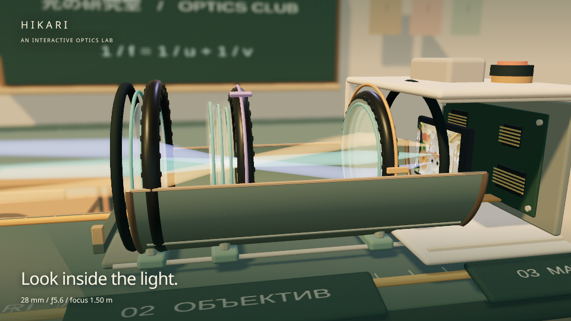
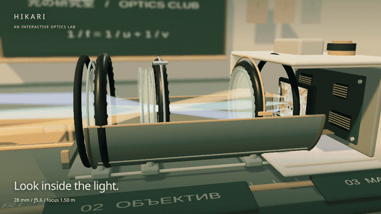
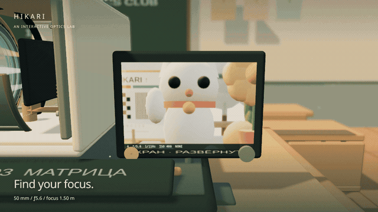
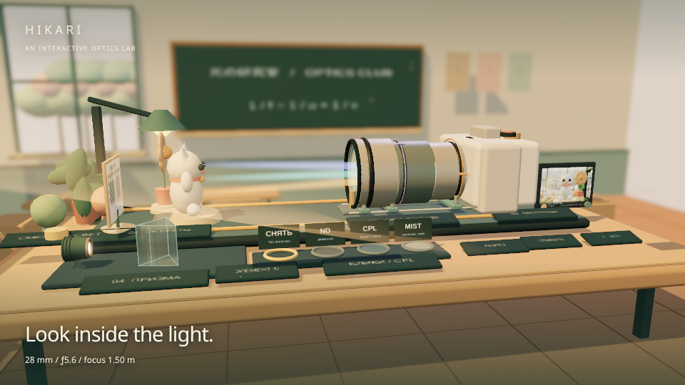
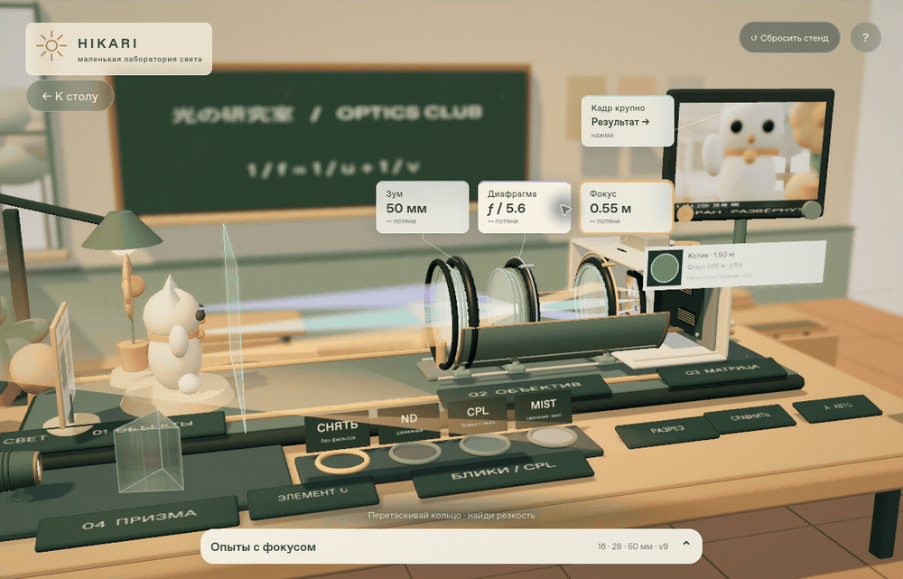
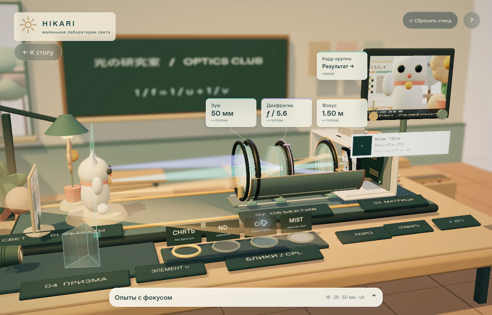

# HIKARI

**A small classroom. A world of optics.** An interactive 3D lab for exploring what happens inside a camera lens.



[Live demo](https://triton556.github.io/hikari-optics/)

**Stack:** Three.js · WebGL · GLSL · JavaScript · Vite

**My role:** Danil Volodin — built the interactive optics lab with AI-assisted development.

## Run locally

Use Node.js **22.12+** or a supported newer release.

```sh
npm ci
npm run dev
```

Open the local URL printed by Vite. A WebGL-capable browser is required; a GPU-backed desktop browser gives the best experience. The help panel includes a lower-quality rendering option.

```sh
npm test       # optics, state, placement and layout regression tests
npm run build # production bundle in dist/
```

Deployment: GitHub Pages via GitHub Actions on every push to `main`.

This repository contains the application source and its test suite. It has no backend, account system, or API key requirement.

## Touch the light

Walk up to a tabletop in a warm, low-poly classroom. Open the lens, turn its rings, move the subjects, and watch the image change on the camera's screen.

Hikari is a hands-on explanation of optics: a place to experiment with the connection between **mechanics, light, and the photograph**.

- **Look inside the lens.** A cutaway reveals nine optical elements, moving groups, an iris, and computed ray paths.
- **Explore focus.** Switch between 16, 28, and 50 mm; focus on the cat, flower, or chart; compare a wide aperture with ƒ/11.
- **Follow the image.** The sensor preview renders the same scene, with approximate depth of field and exposure.
- **Try filters with a purpose.** ND for longer exposures, CPL for polarized glass reflections, and MIST for diffusion around highlights.
- **Bend a beam.** Rotate a prism, glass plate, or mirror in a dedicated tabletop experiment.
- **Change the atmosphere.** Sun, cloud, golden hour, and night alter the lighting; ISO, shutter speed, and automatic/manual exposure affect the camera's image.

### Inside the lens



### Pull focus



### The classroom



## Follow the light

The light-path view keeps the opened lens and the live camera monitor in the same inspection. Adjust focus or aperture and compare the moving group, ray bundle, point footprint and resulting photograph without switching between views. The existing monitor still opens into its usual close-up and returns to its original place when you leave the inspection.

Open the focus shelf, choose **50 mm**, and use the cat, flower or chart shortcuts to set a focus distance. Turn the focus ring while watching the selected target's point footprint. Then compare the open aperture with **ƒ/11**: the iris closes and the out-of-focus footprint shrinks, while the lens groups stay in place. The mint plane marks the focus distance; the highlighted tabletop band is an approximate depth-of-field guide.

Actual cloud Firefox captures of the same scene:






[Portrait layout](media/causal-portrait.png)

## A quick first experiment

1. Approach the bench, or open the focus experiments shelf at the bottom.
2. Choose **50 mm** and focus on the **cat**.
3. Move focus to the **chart**. Watch which part of the image becomes sharp.
4. Compare the open aperture with **ƒ/11**.
5. Switch to the lens cutaway and see the groups move.

The in-app interface is currently in **Russian**. This README is in English.

## Controls

| Action | Control |
| --- | --- |
| Approach an instrument | Click/tap the object or its label |
| Adjust a ring | Drag it; use arrow keys when selected |
| Move a subject | Drag; hold Shift for the other tabletop axis |
| Look around | Drag an empty area |
| Move closer | Mouse wheel |
| Return to the table | Escape or the back button |
| Find instructions / reset | The `?` button / reset control |

If the camera image becomes dark, check the lighting and exposure. In manual mode, a night scene can genuinely underexpose. Switch back to automatic exposure or reset the bench to recover a known starting point.

## Under the glass

- **Shared 3D world:** the visitor view and sensor view use the same Three.js scene.
- **Lens model:** fixed optical powers and moving groups, evaluated with a paraxial ray-transfer model.
- **Refraction experiment:** angle-dependent reflection/refraction and wavelength-dependent prism dispersion.
- **Image formation:** depth-aware shader blur, exposure, and highlight diffusion.
- **Presentation:** procedural low-poly objects, warm lighting, bloom, and restrained depth separation.
- **State:** normalized camera parameters shared by the physical controls and quick experiments.
- **Candidate light-path view:** the existing monitor docks beside the cutaway; a point-footprint annotation uses the same paraxial lens solution as the internal ray bundles.

### Educational boundaries

Hikari is an educational visualization, **not an optical design or camera calibration tool**. The lens is not a reconstruction of a Sony or other manufacturer's optical prescription. Tabletop distances are compressed; ray brightness is exaggerated for visibility. Colored ray bundles in the lens identify different object points, whereas prism colors represent wavelengths. Depth-of-field blur, diffusion, and motion blur are approximations. Overview-camera blur is an artistic effect, separate from the simulated camera image.

The prism experiment displays computed beam spots rather than a full physically based photograph of the classroom. CPL demonstrates a selected dielectric-reflection scenario; it does not remove every kind of reflection. The MIST strength control is educational, not a claim that rotating a real diffusion filter changes its density.

The point footprint is the paraxial blur diameter of a single point on the selected target. The display enlarges it **24×**, uses a small visibility floor at perfect focus, and clips a large spot at the edges. Its grid is symbolic, rather than a model of individual sensor photosites. These display choices do not change the numeric diameter or feed back into the optical solver.

The adjacent photograph is rendered from the shared scene and uses depth-buffer defocus. Its pixels are not formed by tracing every ray through the nine visible elements. The glass profiles and diaphragm blades are illustrative geometry; exposed inspection views may hide foreground glass or rims for readability while retaining their modeled optical effect. No diffraction, interference, calibrated sensor noise or full aberration model is claimed.

The combined inspection was independently implemented from explanatory principles in [Bartosz Ciechanowski's Cameras and Lenses](https://ciechanow.ski/cameras-and-lenses/). No reference code, illustrations, models or other assets are included.

## Project map

```text
src/
  immersive.js          classroom, controls and instrument geometry
  shared-preview.js     sensor view of the shared world
  lens-system.js        lens groups and paraxial propagation
  optics.js             normalized camera state and optical helpers
  refraction.js         reflection, refraction and dispersion
  filter-experiments.js contextual filter demonstrations
  focus-presets.js      focal-length and focus experiments
  light-path.js         combined cutaway, monitor and point-footprint display
  light-path-model.js   selected-target observation and inspection framing
  spectator-focus.js    presentation depth separation
  main.js               interaction and state coordination
test/                    regression tests
media/                   screenshots and animated showcases
```

## Verification

The final native Firefox browser-harness report passes **8 of 8** light-path checks, including an explicit redraw after docking. It checks that docking the monitor leaves the sensor image unchanged; changing focus affects the moving group and actual sensor pixels; stopping down reduces the modeled point diameter without moving the groups; and the existing monitor returns home from its close-up and the table view.

The same final source passes **72/72 Node tests**, including full monitor, stand and plaque projection bounds at eight phone/tablet/desktop sizes. Production build and `git diff --check` pass. Native cloud Firefox checks also cover focus/aperture label dragging, keyboard increments, the image close-up and Escape back to the table. Portrait layout is inspected at 390×720 CSS pixels; this is browser emulation, not a physical-phone performance claim. The build retains Vite’s existing large-bundle warning. No new long-duration soak or GPU benchmark is claimed.

## About the media


The lens and focus loops were rendered locally with **[HyperFrames](https://github.com/heygen-com/hyperframes)** using the application's actual Three.js scene and deterministic GSAP timelines. Titles are showcase overlays, not additional controls in the app. Still images are captures of the same rendered scene.

The new `causal-*` media use **native Firefox 158**, **CUA/Sky screenshots of the live browser page**, and **FFmpeg**. The GIFs are sampled real UI states, held for readability, cropped to the page and palette-encoded. They are not frame-rate demonstrations. The focus loop holds 50 mm, f/5.6 and the cat target constant; the aperture loop holds 50 mm and approximately 0.55 m focus constant. No synthetic optical transitions or third-party scene assets are added. See [capture provenance](qa/causal-captures/README.md).

Built by **[Danil Volodin](https://github.com/Triton556)** with AI-assisted development. An ongoing experiment in making technical ideas tangible, playful, and visually understandable.

## License

[MIT](LICENSE) © 2026 Danil Volodin.
